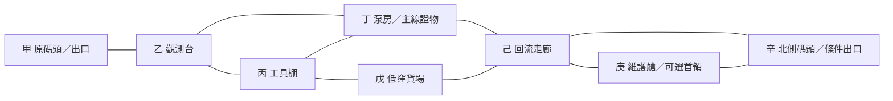

# 第一區：灰潮泵站

返回[[故事/rogue/大綱|大綱]]。活動與損失規則依[[故事/rogue/遊戲框架|遊戲框架]]及[[故事/rogue/搜打撤規則|搜打撤規則]]。

## 目標

主要委託是帶回一份「調壓記錄匣」。它能證明泵站依舊人口資料向現有人居區排水。

玩家可選一個次要目標：帶回調律樣本、取得回流晶核，或修復北側撤離線。主要委託與次要目標都不限制提前正常撤離。

首次交付記錄匣，獲得固定40港幣和下一區的調查線索。這筆報酬只領一次；它不包含在重複遠征的80港幣收穫假設中。

## 地圖骨架

地圖使用八個區域。區域是連續場景中的地點，不是必須逐張切換的房間。

| 邊 | 空場普通步行時間 | 條件 |
|---|---:|---|
| 甲—乙 | 25秒 | 全程開放 |
| 乙—丙 | 20秒 | 全程開放 |
| 乙—丁 | 30秒 | 全程開放 |
| 丙—丁 | 20秒 | 全程開放 |
| 丙—戊 | 30秒 | 12分鐘後關閉，提前公告 |
| 丁—己 | 35秒 | 高架通道，全程開放 |
| 戊—己 | 25秒 | 全程保留高架出口 |
| 己—庚 | 30秒 | 全程開放 |
| 己—辛 | 25秒 | 可以通行；撤離功能另驗供能 |
| 庚—辛 | 20秒 | 全程開放 |

所有邊皆可雙向移動。路線不需先打敗首領才返回。負重移動時間以表中秒數除以0.85估算。交戰、搜索與機關時間另外計入。

丙—戊封路前，告示會提示改走高架。已進入該通道的角色仍可到達戊側高架，再經己返回；關門與水位上升不得把角色夾在無出口的過渡區。

最深處庚經己、丁、乙返回甲，空場步行為120秒。負重時約141.2秒，再加原碼頭12秒撤離。這證明地圖留有返程空間，但不是保證玩家在交戰中也能準時離場。

## 區域內容

| 區域 | 必定存在的資訊或物件 | 風險 | 主要選擇 |
|---|---|---|---|
| 甲 原碼頭 | 潮汐告示、出口、救難契約 | 返程可能被已引來的敵人追上 | 現在撤離，或繼續探索 |
| 乙 觀測台 | 現行水位、第二出口供能狀態 | 一組巡邏可能經過 | 觀察巡邏再走，或直接穿越 |
| 丙 工具棚 | 一件閥芯、兩份銅線、第一個調校站 | 搜索聲響可能招來巡邏 | 留材料帶回，或投入泵房 |
| 丁 泵房 | 調壓記錄匣、修復接口、紙本停機圖 | 錯接噴流週期啟動 | 取證後回頭，或修泵打開第二出口 |
| 戊 低窪貨場 | 普通材料箱、相容補給 | 12分鐘後失去通往丙的短路 | 多拿材料，或避免回程繞路 |
| 己 回流走廊 | 調律樣本、第二個調校站 | 兩處有預告的洩壓噴口 | 觀察時機，或花時間關閉噴口 |
| 庚 維護艙 | 守泵構裝、三處停機控制件 | 首領會封鎖局部通道 | 戰鬥拆解，或完成停機流程 |
| 辛 北側碼頭 | 出口、供能指示與撤離倒數 | 啟動會產生可聽見的機械聲 | 直接撤離，或轉向維護艙 |

接觸觀測台與泵房圖紙後，必要資訊直接取得。可選檢定只影響額外情報、時間或風險，不能把唯一出口提示藏在一次失敗之後。

## 泵房修復

修復需要一件閥芯及一份銅線，連續操作20秒。開始時把材料鎖定為本次操作使用；完成時才消耗。中斷時材料回到原持有處，修復進度歸零。

完成修復會產生三個結果：

1. 北側碼頭取得穩定供能，開放18秒撤離。
2. 丁的一處噴流關閉。
3. 「灰潮泵站已修復」世界旗標保存，後續遠征不再重收同一修復費。

修復使用既有接口與經校驗的工具操作。它不代表玩家已學會完整星脈調律，也不讓低階角色重建整座天衡網。

若玩家已帶走或出售閥芯，仍能用原碼頭撤離。下一次遠征有新的工具補給來源，不因這次選擇永久卡住主線。

## 敵人

| 敵人 | 可觀察行為 | 對應方法 | 主要掉落方向 |
|---|---|---|---|
| 潮蝕拾荒獸 | 靠氣味與足音接近；撲擊前壓低身體 | 離開直線、利用障礙；陰影不會遮住氣味 | 凝膠或樣本線索 |
| 舊令巡檢機 | 沿固定區域巡查；攻擊前亮起定向燈 | 利用視線死角，觀察轉向與收招 | 銅線、絕緣片 |
| 非法拆解者 | 搜索貨箱；聽到噪音會到聲源調查 | 引開、迂迴或戰鬥；不是全知AI | 工具材料與脈晶 |

三類敵人都有可辨識的偵測方式。首版先測單體，再測兩種互補的混合遭遇。避免第一場同時出現三種新規則。

## 可選首領：守泵構裝

守泵構裝正在執行過時排放命令。它保護維護艙，不是主線必殺目標。

| 行為 | 預告 | 後果 | 反制 |
|---|---|---|---|
| 橫臂掃擊 | 手臂後拉，地面標示扇形 | 擊中扇形內目標 | 離開範圍，利用收招移動 |
| 直線洩壓 | 管口發光，出現尖銳泄氣聲 | 沿直線噴出高壓流體 | 側移或躲在完整隔板後 |
| 呼叫巡檢 | 警燈旋轉，維護門開啟 | 一組預先配置巡檢機進場 | 在增援到達前換位置；本場最多一次 |

**戰鬥解法**：破壞可攻擊部位並擊敗構裝，取得一件受損回流晶核。損傷是公開戰鬥後果。

**停機解法**：依丁的圖紙，先隔離用途設備，再釋放緩衝壓力，最後接通已確認的低壓回流道。三個控制件各需6秒連續操作。每步成功後保留本場進度；中斷只重做當前步驟。

停機期間構裝仍會攻擊，玩家需用掩護與控制爭取時間。完成後可用12秒安全拆取，取得一件完整回流晶核。若只完成停機而未拆取，沒有實體核心獎勵。

戰鬥與停機是同一來源的兩種完成方法，不能各領一次。兩者給相同的來源研究進度；實體完整性依公開方法決定。

本稿尚未定義首領生命、攻防及各招傷害。數值必須以核准角色的既有傷害公式測算。不能把這份行為表當作已平衡的敵人資料。

## 首版來源草案

首版先用固定物品驗證選擇。常規隨機池、稀有池、隨機階級與直接貨幣支付均為「無」。下表物品階級均為普通；完整性只有首領依方法改變。每次合格完成來源增加1點來源研究進度，首版尚無稀有候選可兌換，進度保留。

| 來源實例 | 完成條件 | 必掉或固定產出 | 本次上限 |
|---|---|---|---:|
| 工具棚補給箱 | 完成4秒搜索 | 閥芯1、銅線2 | 1次 |
| 貨場材料箱 | 完成4秒搜索 | 絕緣片2、凝膠2 | 1次 |
| 巡檢機零件 | 完成一組預設巡檢遭遇 | 銅線2、脈晶1 | 2組，各自唯一實例 |
| 拾荒獸樣本點 | 完成一次採樣，需可接近的屍體或安全遺留物 | 凝膠1 | 1次 |
| 拆解者藏箱 | 以戰鬥或引開方式取得接近條件，再完成搜索 | 絕緣片2、脈晶1 | 1次 |
| 回流採樣口 | 關閉噴口後完成6秒採樣 | 調律樣本1 | 1次 |
| 維護艙核心 | 戰鬥擊敗，或停機後完成拆取 | 回流晶核1，完整性依方法 | 1次 |

調壓記錄匣由委託契約提供，獨立於掉落池。未交付時，保證在丁取得。若已持有一份，不能再產生第二份；若救難遺失，下一次可取得校驗備份。完成委託後不再重發報酬。

來源研究進度使用表中各自的來源家族與普通獎勵層級，不把所有箱子混成一個可兌換任何物品的進度條。

新一次遠征發生在下一個作業窗口。新露出的貨箱、流入的材料、遷入敵人或不同編號的維護構裝提供新來源。已交付證物、已修好的泵及獨特劇情成果不重置。來源補充須在出發情報中說明，不能把同一個已搬空箱子無理由填滿。

## 每次變化的範圍

首版只允許三種變化：巡邏行進方向、貨場箱子的合法位置，以及工作站提供的相容調校。第一場教學固定使用一組配置。

後續可增加暴雨、漏電或敵方打撈事件，但每一項都要有預告與替代路線。不得隨機改變主線證物的位置、刪除原碼頭，或覆蓋已修復的世界旗標。

## 紙上試玩腳本

1. 給玩家一張已知入口、未知支路的地圖，以及可承受一次失敗的普通配置。
2. 在乙提供必要資訊。記錄玩家能否說明何時潮封、如何回到原碼頭。
3. 在丙給固定材料。詢問玩家會帶回還是修泵，記下理由。
4. 在丁完成取證後，給出「返回」與「繼續」兩條可見路線。
5. 在己加入樣本和背包壓力。讓玩家自行放棄、替換或保留物品。
6. 在庚測戰鬥與停機兩種方案。首輪可由主持人估時，不把估時當成戰鬥平衡證據。
7. 撤離後列出實際帶回、現場遺留及永久紀錄。再重跑一次失能分支。

測試需記錄玩家在何處考慮撤離，以及拒絕深入的具體原因。只有「玩得開心」不足以證明搜打撤循環成立。

---
#關卡 #沉冠遠征 #灰潮泵站 #設計草案
